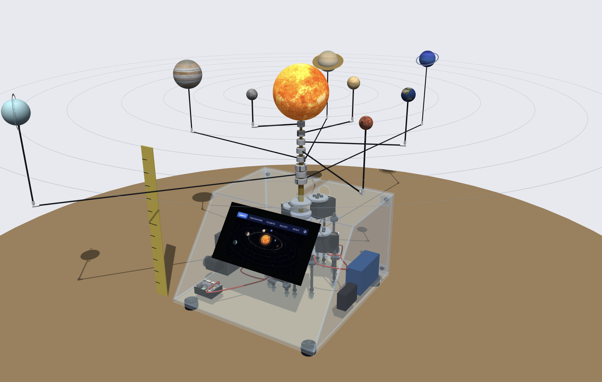

# Date-Dial Orrery

A model of the solar system where you **pick any date on a touchscreen and the eight planets
swing round the Sun to where they really were** (or will be) on that day. Built as an
8-year-old's school science project in September–November 2026.

A Raspberry Pi works out each planet's position with NASA JPL's formulas and sends it to
eight smart servo motors, one per planet. Each servo turns a brass tube through a pair of
40-tooth gears (1:1). The eight tubes are nested like a telescope, so all the drives come up
through one hole in the box, and each tube carries an arm with a painted foam planet.

## What's in this repository

| Folder | What's inside | Start with |
|---|---|---|
| [`docs/`](docs/) | Everything you need to reproduce it: mechanical design with every dimension, parts list, wiring, assembly steps, software design, tests, and how to run and look after it. Also the kids' engineering design document (PDF). | [docs/README.md](docs/README.md) |
| [`templates/`](templates/) | Full-size printable templates (PDF) for drilling the base, the servo plates, cutting the box panels and the screen opening, and the planet rings | [templates/README.md](templates/README.md) |
| [`pi/`](pi/) | The program that runs on the Raspberry Pi: planet maths, servo control, the touchscreen app, bench tools and tests | [pi/README.md](pi/README.md) |
| [`model-3d/`](model-3d/) | An interactive 3D model of the whole orrery, with the real touchscreen running in simulation | [model-3d/README.md](model-3d/README.md) |

## How to build one, in order

1. Read [docs/mechanical-design.md](docs/mechanical-design.md) and buy the parts in
   [docs/bill-of-materials.md](docs/bill-of-materials.md).
2. Set up the Pi and number the servos: [pi/README.md](pi/README.md).
3. Build it step by step with [docs/assembly-procedure.md](docs/assembly-procedure.md), printing
   the [templates](templates/) at 100 % as you go, and wire it with
   [docs/electrical-design.md](docs/electrical-design.md).
4. Test it ([docs/testing-and-verification.md](docs/testing-and-verification.md)) and use it
   ([docs/operation-and-maintenance.md](docs/operation-and-maintenance.md)).

## Licence

MIT (see [LICENSE](LICENSE)). three.js and the planet maps keep their own licences, listed
there.
