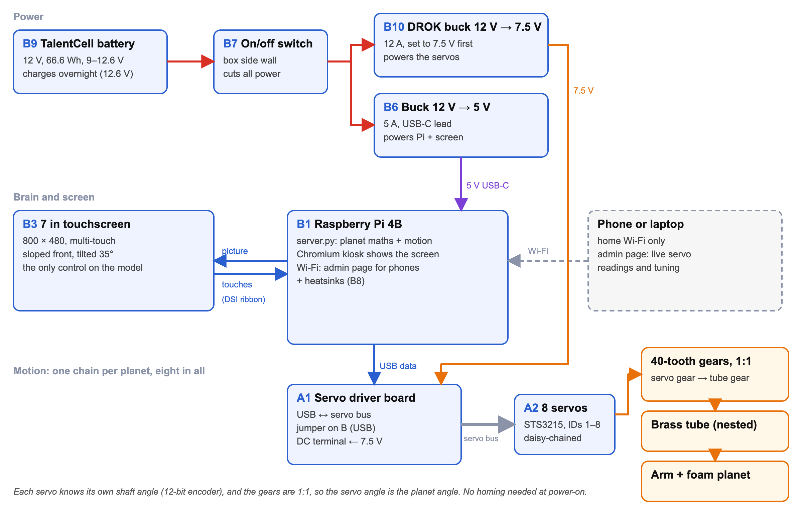
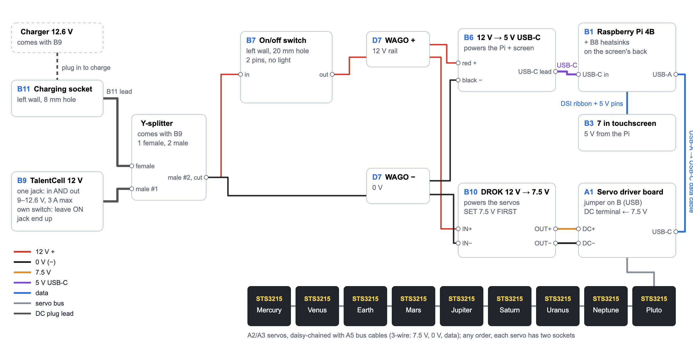
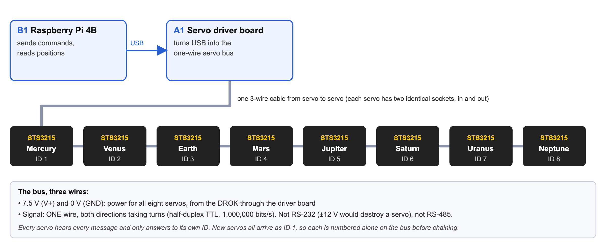

# 5. Electrical Design

This section describes how the orrery is powered, how its parts are wired together, and how the computer talks to the eight servo motors. It records the design as it stands on 14 Nov 2026. Where a decision replaced an earlier one, the earlier choice is noted in one line.

## 5.1 Overview and block diagram

The model runs on its own rechargeable 12 V battery, so it does not need a wall outlet at school. One on/off switch turns everything on and off. Two small converters turn the battery's 12 V into the two voltages the model needs: 7.5 V for the servos and 5 V for the computer.

The computer is a **Raspberry Pi 4B**. It sits on the back of a **7 in touchscreen**. The Pi talks to the eight servos through a small **servo driver board** plugged into one of its USB ports. The servos are chained one to the next on a single three-wire cable.

*Replaced: an Arduino Mega was the first plan for the brain (dropped 20 Sep 2026); a 16×2 text display and a turning knob were the first plan for the controls (replaced by the touchscreen 21 and 26 Sep 2026); a 5 in screen was used until the 7 in arrived (swap chosen 27 Sep 2026).*

### Block diagram (power path)

| Stage | Part (parts-list code) | Input | Output | Feeds |
|---|---|---|---|---|
| 1 | TalentCell 12 V battery pack, YB1206000-USB (B9) | 12.6 V charger, through the charging socket | 9 to 12.6 V DC, 3 A max | Y-splitter, then the on/off switch |
| 2 | Round rocker switch, 2-pin, 20 mm (B7) | Battery + | Switched 12 V + | WAGO lever connector "12 V rail" (D7) |
| 3 | WAGO lever connectors (D7), + and − | Switched 12 V and battery − | Two 12 V branches | Both converters |
| 4a | DROK adjustable buck converter, 12 A, with display (B10) | 12 V rail | **7.5 V** | Servo driver board DC terminal, then all eight servos |
| 4b | 12 V to 5 V, 5 A buck converter with USB-C lead (B6) | 12 V rail | **5 V** USB-C | Raspberry Pi 4B power input |
| 5 | Raspberry Pi 4B, 4 GB (B1) | 5 V USB-C | 5 V on its header pins; DSI video; USB | Touchscreen (power and picture); servo driver board (data) |

### Block diagram (data path)

| From | Link | To | What it carries |
|---|---|---|---|
| Raspberry Pi 4B | DSI ribbon cable to the Pi's DISPLAY socket | Freenove 7 in touchscreen (B3) | Picture, touch, backlight control |
| Raspberry Pi 4B, USB-A port | USB-A to USB-C **data** cable | Servo driver board (A1), USB-C socket | Servo commands and replies (appears on the Pi as a serial port) |
| Servo driver board servo port | 3-wire servo bus cable (A5), 8½ in | Mercury servo (ID 1) | 7.5 V, 0 V, and the one-wire data signal |
| Each servo's second socket | 3-wire servo bus cable (A5) | The next servo: Venus, Earth, Mars, Jupiter, Saturn, Uranus, Neptune | The same three wires, daisy-chained |

Nothing electrical goes up the brass column. The servos stay in the box and turn the planet tubes through gears.

## 5.2 Power supply and distribution

### Battery

- **Pack:** TalentCell YB1206000-USB, 12 V, 6000 mAh, 66.6 Wh (about 60 Wh usable). Output 9 V (empty) to 12.6 V (full), 3 A maximum. Size 5.7 × 3.35 × 1.1 in.
- **Why this pack:** it gives 12 V straight from a barrel socket. USB power banks only give 12 V through a special adapter, may turn themselves off at light load, and often cut out when a charger is plugged in. The TalentCell keeps running while it charges.
- **One jack does both jobs.** The pack has a single 12 V jack that is both its charging input and its output. The Y-splitter that comes with it shares that jack: one male end into the battery, the charging socket lead into the female end, and the other male end cut off and wired to the switch.
- **Battery's own switch:** left ON. The box's rocker switch does the work.
- **Charging:** plug the TalentCell's own 12.6 V, 1 A charger into the panel socket in the left wall. About 10 hours from empty (overnight). The pack's five LEDs show the charge level. The model can run while charging.
- **No inverter.** Turning battery DC into 120 V AC only to turn it back into DC would waste about a fifth of the energy.

### Converters

- **Servo converter (B10):** DROK adjustable buck, rated 12 A, with a built-in voltmeter. Set to **7.5 V before the servos are connected**. The servos are rated 7.4 V and must never get 12 V. Its output is set to come on by itself at power-up (hold ON/OFF until it shows ON), or the switch would start the Pi but not the servos. Its display, switched to show input volts, is a rough battery gauge: 12.6 V is full, about 9.5 V means charge it.
- **Pi converter (B6):** 12 V to 5 V, 5 A, with a USB-C lead into the Pi. It accepts 12 to 24 V nominal, so the battery's 9 to 12.6 V range is fine.
- Both converters accept anything from about 6 V upward, so the servos and the Pi see a steady 7.5 V and 5 V as the battery runs down.

### Mounting in the box

- Battery: on its edge against the left wall, 12 V jack at the top, LEDs facing in, held with velcro, starting 1.4 in in from the back edge.
- Charging socket: left wall, behind the battery, 8 mm hole, centre 1.45 in up from the bottom of the box and 1.0 in from the back edge.
- Switch: left wall, 20 mm hole, centre 1.55 in up from the bottom of the box and 4.0 in from the front.
- 7.5 V converter: right wall, on 0.1 in standoffs, 0.3 in off the floor, centred 2.8 in behind the middle.
- 5 V converter: right wall, just in front of the middle.
- Servo driver board: floor, front left.
- Pi: screwed to the back plate of the touchscreen, under the sloped front panel.

## 5.3 Power budget

### Rails

| Rail | Source | Voltage | Rating | Measured |
|---|---|---|---|---|
| Battery / 12 V rail | TalentCell pack | 9 to 12.6 V | 3 A max (36 W at 12 V, about 28 W near empty) | Switch cuts all power; switching on brings everything up (3–4 Oct 2026) |
| Servo rail | DROK buck | 7.5 V (servos read 7.2–7.3 V at their own terminals) | Converter 12 A; each servo's over-current trip is 3.25 A for 2 s | About **1 A** at 7.5 V for all servos spinning at full speed, no arms fitted (3–4 Oct 2026) |
| Pi rail | 5 V USB-C buck | 5 V | 5 A | Pi reported no under-voltage (throttle flag 0x0) on battery, 52 °C (3–4 Oct 2026) |

### Measured servo currents (one servo, Mercury)

| Condition | Current | Date |
|---|---|---|
| Spinning free, no gear | 5 to 120 mA | 30 Sep 2026 |
| Starting a move to a new date (peak) | about 190 mA | 30 Sep 2026 |
| Turning slowly with its gear on, free | about 6 mA | 2 Oct 2026 |
| Held back hard by hand, 30 % power cap | 70 to 104 mA | 2 Oct 2026 |

### Estimated whole-model power and run time

These are design estimates (written for nine servos; the model now has eight, so real figures should be a little lower). The run time on the battery is still to be measured.

| What the model is doing | Pi + 7 in screen | Servos | From the battery, after converter losses | Run time on about 60 Wh |
|---|---|---|---|---|
| Paused, children exploring the screen tabs | 6.5–8 W | 2–3.5 W (holding) | 10–13 W | 4½–6 h |
| Mixed (planets turning about ⅓ of the time) | 6.5–8 W | 4–8 W | 12–18 W | 3½–5 h |
| Planets turning non-stop | 6.5–8 W | 7–17 W (100–250 mA each at 7.5 V) | 16–28 W | **2–3½ h** |

The need at a school or science fair is 1–2 hours, so the battery has margin. The biggest draw is all servos starting at once. The software ramps speed up over about 1 second to keep that peak inside the battery's 3 A limit. Since 7 Nov 2026 the top run speed is 100 years per minute (was 1,000) and date moves are capped at 600 steps/s, which lowers servo power further.

## 5.4 Wiring table

*The model uses eight servos (Mercury to Neptune); the Pluto servo in the drawing is a spare.*

Wire colours on the cut splitter lead are not trusted: the + wire is found with a multimeter before connecting.

| # | Connector | From | To | Wire | Notes |
|---|---|---|---|---|---|
| 1 | 5.5 × 2.1 mm barrel plug | 12.6 V charger | Charging socket (B11), left wall | Charger's own lead | Plug in to charge; the model can run while charging |
| 2 | 5.5 × 2.1 mm barrel plug | Charging socket lead, male end | Y-splitter, female end | B11 extension lead (4.9 ft; spare coiled inside) | Panel socket held by its nut |
| 3 | 5.5 × 2.1 mm barrel plug | Y-splitter, male end 1 | Battery 12 V jack | Splitter cord | Battery stands jack-end up so the plug clears the lower magnet block |
| 4 | Stripped wire into WAGO / switch tab | Y-splitter, male end 2 (cut off), + wire | Switch "in" pin | Splitter's 2-wire cord, stripped about ⅜ in | Joined with a WAGO connector, or soldered with heat-shrink. Find + with a meter |
| 5 | WAGO 221 lever connector | Y-splitter, male end 2, − wire | WAGO "−" (0 V) | Splitter cord | The common 0 V point |
| 6 | Switch tab / WAGO | Switch "out" pin | WAGO "+" (12 V rail) | Pre-wired switch lead | Switch has two pins, no light, no ground wire |
| 7 | WAGO to screw terminals | WAGO + and − | 5 V converter (B6), red + and black − | Converter's input leads | 12 V in |
| 8 | WAGO to screw terminals | WAGO + and − | DROK converter (B10), IN+ and IN− | Hook-up wire [check gauge] | 12 V in |
| 9 | USB-C | 5 V converter (B6) lead | Pi 4B USB-C power socket | Converter's USB-C lead | A right-angle plug gives the most room under the ceiling |
| 10 | Screw terminals | DROK OUT+ and OUT− | Servo driver board DC+ and DC− | Hook-up wire [check gauge] | Set 7.5 V first. OUT− goes only to the driver board, never also to the WAGO −. The DROK output has no reverse-polarity protection |
| 11 | USB-A to USB-C | Pi USB-A port | Servo driver board USB-C | USB **data** cable | The first cable tried was charge-only and did not work. Board jumper set to the USB side. If the screen stays on the desktop at start-up, reseat this cable |
| 12 | DSI ribbon | Pi DISPLAY socket | Touchscreen | Flat ribbon supplied with the screen | Metal contacts toward the Pi's USB/Ethernet ports, blue stiffener toward the micro-SD edge. Strain-relieve it: a bump made the screen flash until it was pushed back in |
| 13 | Spring pins | Pi 5 V and GND header pins | Touchscreen power | Two gold spring pins on the screen's board | The Pi must stay screwed down on the screen's back plate, or the picture stays dark. The pins are live 5 V when the Pi is off the plate |
| 14 | 5264 3-pin servo plug | Driver board servo port | Mercury servo (ID 1) | A5 servo bus cable, 8½ in | 3 wires: 7.5 V, 0 V, data. Plugs lie flat under each servo |
| 15–21 | 5264 3-pin servo plug | Each servo's second socket | Next servo: Venus (2), Earth (3), Mars (4), Jupiter (5), Saturn (6), Uranus (7), Neptune (8) | A5 servo bus cables, 8½ in each | Each cable runs along its plate's side edge, outside the lock nut, round the outside of the servo ring, slack bowed away from the gears, taped to each plate. Route the Jupiter-to-Saturn cable round the Pi (only 0.12 in apart in the 3D fit check) |

Electrically the servos can be chained in any order, because each one answers only to its own ID number. The chain is built in planet order so the cables run neatly round the ring.

## 5.5 Servo bus and communication

### One bus, not eight connections

All eight servos share one three-wire chain: **GND, V+ and Signal**. Each Feetech STS3215 has two identical 3-pin sockets, in and out, so they plug one into the next. Every message on the wire starts with the ID number of the servo it is for. Only that servo acts on it and answers.

### Signal type

- **Half-duplex TTL serial at 1,000,000 bits per second (1 Mbps).** One wire carries data in both directions, taking turns.
- It is **not RS-232**. RS-232 swings to ±12 V and would destroy a servo.
- It is **not RS-485**. RS-485 uses a pair of wires. Feetech's SMS series is RS-485; the STS series used here is TTL.

### Message format

Every packet, in both directions, has the same shape: two start bytes (FF FF), the servo ID, a length, an instruction (or, in a reply, an error byte), the data, and a checksum. The project uses only three instructions: PING (is anyone there?), READ (read registers) and WRITE (write registers). Two-byte values are sent low byte first. The software reads position, speed, load, voltage, temperature, status and current in one 15-byte read per servo, which takes about 0.6 ms per servo.

### Why a driver board is needed

- A computer's serial port has **separate** transmit and receive wires. The servo bus has **one shared** wire. Something has to switch between talking and listening at 1 Mbps. The driver board (Waveshare Bus Servo Adapter (A), parts-list A1, about $12) does that.
- With the Pi, the board is simply a USB-to-servo-bus adapter. Its USB chip (a CH343) shows up on the Pi as an ordinary serial port. Using USB avoids any wiring to the Pi's own pins and any 3.3 V / 5 V signal-level question.
- The board also takes the 7.5 V from the DROK converter on its DC terminal and passes it to the servo chain. **Servo power never comes from the Pi.** The Pi shares only the data path (through USB) with the bus.
- A resistor-and-diode trick can fake half duplex, but it is unreliable at 1 Mbps and not worth the risk for a $12 part.
- This board does not echo the computer's own messages back. The driver software checks for echo anyway and handles either case.

### Software owner of the bus

Only one program may use the bus at a time. Normally that is the touchscreen program, which runs as a background service from power-on. Bench tools (servo_tool.py, number_chain.py, hold_test.py and others) are only run after that service is stopped.

## 5.6 Servo ID numbers and numbering procedure

| Planet | Mercury | Venus | Earth | Mars | Jupiter | Saturn | Uranus | Neptune |
|---|---|---|---|---|---|---|---|---|
| Servo ID | 1 | 2 | 3 | 4 | 5 | 6 | 7 | 8 |

*Replaced: the model was planned with nine planets, Pluto being ID 9. Pluto was dropped from the physical model on 19 Oct 2026 and the software stopped looking for a ninth servo on 7 Nov 2026. Pluto still appears on the touchscreen's 3D views and fact pages.*

- IDs 0 and 254 are "broadcast" addresses that every servo listens to, so numbering starts at 1.
- The ID is stored in the servo's own memory and survives power-off. It is set once per servo.
- Every servo leaves the factory as **ID 1**. If two factory-fresh servos were on the bus together while being renumbered, both would take the new number and neither could be told apart afterwards.

### Numbering procedure (as used 25 and 28 Sep 2026)

1. Stop the touchscreen service so the bench tool can own the bus.
2. **Unplug the already-numbered chain.** Mercury is ID 1, the same as a new servo, so a lone Mercury would be renumbered by mistake.
3. Plug **exactly one** new servo into the driver board.
4. Run **number_chain.py** (or **servo_tool.py set-id N**). The tool checks that only one servo answers, gives it the next planet's number, and wiggles it so it can be identified. It refuses to hand out a number already used.
5. Label the servo with tape: number and planet name.
6. Repeat for each servo, telling the tool which numbers already exist (for example "--have 2 3 4 5 6").
7. Chain all the servos together and run the **roll call** (number_chain.py --roll-call): each servo wiggles in ID order. All must answer.
8. Restart the touchscreen service and check the settings screen shows every servo connected.

Lesson learned (25 Sep 2026): building the chain up one servo at a time went wrong once (a servo dropped off the bus as the next was added, and two ended up with the same ID). Numbering each servo alone on the board, then chaining at the end, is simpler. Spare servos stay at ID 1, labelled "spare", and are renumbered to whichever planet they replace.

### Firmware

No firmware update is needed. The ID, angle limits and torque limit are settings stored in the servo, written over the same bus. All servos read firmware version 3.10 (30 Sep 2026). Feetech's own firmware updater runs only on Windows and is kept as a last resort.

## 5.7 Servo configuration and position sensing

### The servo

Feetech STS3215, 7.4 V, 1:345 internal gearing, about 1.5 N·m. It has a **12-bit magnetic encoder** on its output shaft, so it always knows its own angle. The planet gears are 40 teeth on the servo and 40 teeth on the tube (1:1), so **the servo's angle is the planet's angle**.

### Settings the software applies

| Setting | Value | Why |
|---|---|---|
| Resolution | 4096 steps per turn (0.088° per step) | Fixed by the encoder |
| Multi-turn mode | Both angle limits set to 0 | Lets a planet keep going round past one lap. The internal counter runs to about ±7 turns |
| Torque (power) limit, register 48 | **80 %** (800 of 1000), written every time a servo is connected | On this servo the power cap also caps top speed. 80 % lets Mercury reach 40 rpm. *Replaced: the first design used 10–15 % so a grabbed arm would slip; raised 25 Sep 2026 after bench tests showed 15 % gave only about 7½ rpm* |
| Position mode / wheel mode | Position mode for date moves and slow arms; wheel (constant-speed) mode for fast arms in Run | Wheel mode cannot run slower than 50 steps/s (see 9.3). Switch points 100 / 70 steps/s so an arm does not flick back and forth |
| Date-move speed | 600 steps/s (about 8.8 rpm) | Cut from 2400 on 7 Nov 2026 so the plastic gears do not slip |
| Run-mode top speed | Mercury 40 rpm; each planet further out at 75 % of the one inside it (Venus 30, Earth 22.5, Mars 16.9, Jupiter 12.7 rpm) | Measured no-load maximum is about 50 rpm. The step-down keeps racing arms in the right order (14 Nov 2026) |
| Ramps | Speed changes by at most 250 steps/s per 0.1 s (about 1 s from full speed to stop) | Done in software: the servo's own acceleration setting gave uneven stops. Gentler on gears and arms |
| Direction | +steps = clockwise seen from the servo horn; software setting ARM_DIR = 1 | The gear mesh reverses direction, so the planets go anticlockwise seen from above, as real planets do |
| Movement direction rule | Arms only ever turn forward (the planets' own direction) | Builder's decision, 7 Nov 2026. A target less than 2° behind an arm is treated as "already there" |

Most of these values can be adjusted live from the admin page and are saved on the Pi, within safe ranges (for example, the power cap 10–100 %, date-move speed 150–600 steps/s).

### Knowing where the arms are

- **At power-on** the software reads every servo's position. It knows exactly where each arm points straight away: no homing sweep, no lining the arms up by hand, nothing to drift. Because the gears are 1:1, this works even after a power cut.
- At start-up the arms go to the saved date. If they are already within 30° of it (for example after a run was cut short), they stay put and catch up on the next move.
- Moves to a date go the short way round, but always forward.

### Re-anchoring the turn count

In multi-turn mode the servo counts whole turns inside itself, but its position register only reports 0 to 4095 (one turn). After an arm has wound up several turns, a goal worked out from the register can send it several turns the wrong way. This happened on the bench on 25 Sep 2026 (Mercury ran away backwards). Switching a servo to wheel mode and back resets its internal count to match the register. The software therefore "re-anchors" a servo:

- at start-up and whenever a servo is (re)connected,
- before any move to a date after Run mode,
- whenever the count passes 4 turns.

During a re-anchor the motor is switched off, the mode is changed, the current position is made the goal, and only then is the motor switched back on. This stops a backwards jerk found on 7 Nov 2026. Each re-anchor writes the mode setting twice to the servo's permanent memory (see open item on memory wear, 9.6).

### Home position (travel mode)

The settings screen has a **TRAVEL MODE** that turns every arm to point away from the screen, all planets in one straight row. It is used for carrying the model, for clamping the arms on during assembly, and as a quick check that every arm is calibrated. A servo with no saved home goes to the step that stands for that direction, and its arm is clamped on pointing that way. An arm that ends up off the line can be stepped 1° or 10° at a time in MANUAL mode and its home saved (SAVE HOME, two taps). Homes are stored on the Pi and survive power cuts. *Replaced: until 13 Nov 2026 this was "LINE UP", pointing out over the screen.*

### Servos that drop off the bus

If a servo stops answering (for example a bumped cable), the software marks it as lost and keeps the other planets going. A power cut also switches a servo's motor off. While the model is paused the software looks for missing servos every 5 seconds and re-attaches any that answer: motor back on, turn count re-anchored, arm sent to the date. Missing servos are not searched for while running, because each search stalls the bus about 50 ms and made the arms jerk.

## 5.8 Raspberry Pi and touchscreen

### Raspberry Pi

- Raspberry Pi 4 Model B, 4 GB (reused from another home project), Raspberry Pi OS 64-bit with desktop.
- Stick-on heatsinks (B8) on the processor, memory, USB chip and power chip, because the Pi sits in a closed box. (to check: confirm fitted)
- At power-on it starts the orrery program as a background service, and a full-screen web browser (kiosk mode) shows the touchscreen app. Boot takes about 25 s. The servos hold no torque until the program starts.
- The same app can be opened from any browser on the home network, and a separate admin page shows live servo readings and tuning settings.
- The settings (gear) screen shows the Pi's temperature, CPU load, any throttling or under-voltage, and each servo's connection, temperature, load, current and encoder reading.

### Touchscreen

| Item | Detail |
|---|---|
| Model | Freenove FNK0078H, 7 in, 800 × 480, capacitive 5-point touch, black glass front |
| Connection | DSI ribbon to the Pi's DISPLAY socket; power from the Pi's 5 V header pins through two spring pins |
| Display driver | config.txt line **dtoverlay=vc4-kms-dsi-7inch** (the screen behaves like the official Pi 7 in display; auto-detect did not find it). The Pi then reports DSI-1 connected |
| Backlight | Controller at I²C address 10-0045; no brightness button, software only |
| Touch device | FT5x06 controller at 10-0038, seen by the system as "10-0038 generic ft5x06 (79)" |
| Multi-touch fix | The desktop (labwc) normally turns touches into a single mouse pointer, which stops pinch-to-zoom. A user setting (mouseEmulation="no" for this touch device) turns that off. If the 7 in screen's touch device has a different name, the rule must be updated. (to check: name confirmed on the 7 in) |
| Mounting | From the **front** of the sloped panel (9 Nov 2026). The opening is the size of the metal tray behind the glass, about 6 11/16 × 4 1/16 in. Tray and Pi pass through; the glass's own 3M tape sticks its lip to the outside face and hides the cut edge |
| Angle | The front panel leans back **37.1° from upright** (11 Nov 2026 lower box; was 35°), facing up at a child standing at the table |

*Replaced: the 5 in Freenove screen (FNK0078) was used from 25 Sep to the end of Sep 2026 and returned. All the screen software was written on it; the 7 in uses the same driver and resolution, so no software change was needed.*

## 5.9 Safety

### Electrical

- **Low voltage only.** Nothing in the box is above 12.6 V. There is no mains wiring; the only mains part is the battery's own plug-in charger.
- **Fusing:** no fuse is shown in the design. (to check) Current is limited by the battery's own 3 A output limit and by each servo's built-in over-current protection (3.25 A for 2 s). The DROK converter has an optional current limit (set to about 3 A) so a jam dips only the servos instead of tripping the battery and the Pi. (to check: whether this limit was set)
- **Set the servo voltage first.** The DROK is set to 7.5 V with nothing on its output. Never feed the 7.4 V servos 12 V.
- **Polarity.** The DROK's output has no reverse-polarity protection; its − output goes only to the driver board.
- **Live pins.** The touchscreen's spring pins are live 5 V when the Pi is lifted off the screen's back plate.
- **Power switch and the SD card.** The rocker switch cuts power to a running Pi, which can damage the files on its memory card. The on-screen "Turn off" button was removed on 13 Nov 2026 (the shutdown function is still in the software). A read-only file system is the planned fix (see 9.6). When the program is stopped normally it ramps spinning arms down, holds them, and saves the date.
- **Cables.** Every cable is tied down inside the box. A bumped cable once cut off every servo mid-run, and a bumped screen ribbon made the screen flash.
- **Heat.** The Pi slows itself down from about 80 °C, so heat costs speed, not damage. The settings screen shows green below 70 °C, amber 70–80 °C, red above 80 °C.

### Moving parts and children

- **Countdown before the arms move.** Tapping a TIME MACHINE moment or GO shows a big "3, 2, 1" over the whole screen with "Stand back!" and where the planets are going. Tapping anywhere stops it. The same countdown appears going into and out of travel mode, when Run is pressed in travel mode, and when switching from MANUAL to AUTO.
- **Power cap.** The servos run at an 80 % power cap. A hold test showed an adult hand cannot stop the servo even at 30 %, so the cap does not make a grabbed arm slip. Safety therefore comes from the light parts (foam balls on thin wire arms), slow date moves (600 steps/s, about 8.8 rpm), the speed ramps, and the countdown. A stall guard that stops a blocked arm is planned (9.6).
- **Servo self-protection.** Each servo switches its own motor off if it is overloaded (80 % load for 2 s), draws too much current (3.25 A for 2 s), or reaches 70 °C. The settings screen shows any trip in red with a plain-words message.
- **Sweep area.** Neptune's arm sweeps a circle about 43½ in across. Keep that area clear of faces and loose items when the model runs.
- **Arm attachment.** Each arm's collar is held by its clamp screw only (no glue on the tubes), so arms can be taken off for transport.
