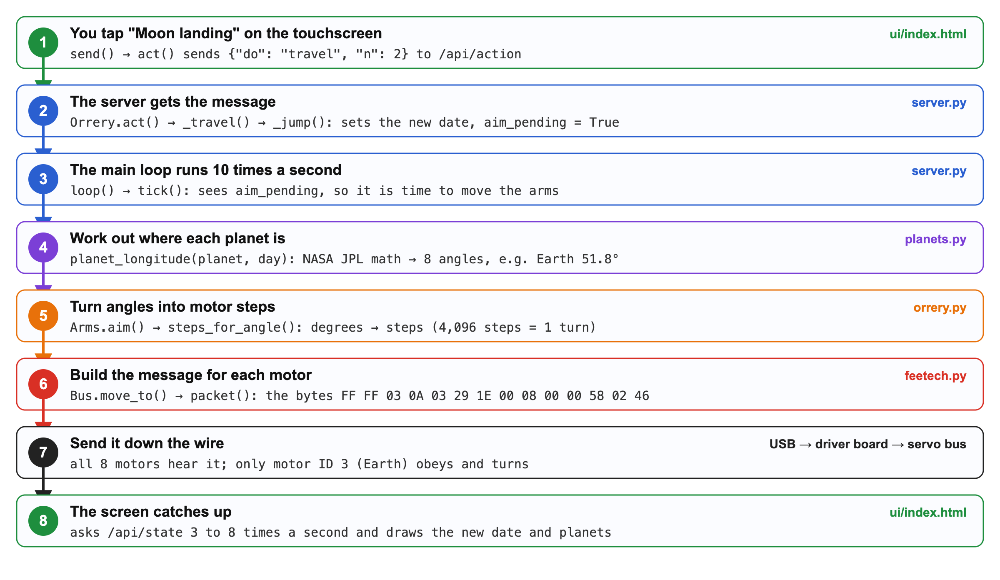

# 6. Software Design

The orrery is driven entirely by software running on a Raspberry Pi 4B inside the box. The Pi works out where each planet really is for a chosen date, turns eight servo motors so the brass arms point there, and runs the 7 in touchscreen on the front of the box. This section explains how that software is organised, the maths behind the planet positions, how the motors are moved safely, what each screen does, and how the software is built, installed and tested. All of it is written in Python (the "brain") and JavaScript (the screen), and none of it needs the internet to run.

Throughout this section, a **planet's angle** means its direction from the Sun, measured in degrees counter-clockwise as seen from above the Sun's north pole (astronomers call this *heliocentric ecliptic longitude*). The model shows angles, not distances: every arm is a fixed length, but every arm points the true way.

## 6.1 Architecture overview

The design follows one simple rule: **a single program owns the motors and all the decisions**. That program is *server.py*, a small web server. Everything else (the touchscreen, the admin page on a laptop, the 3D model page in model-3d/) is a web page that asks the server what to show and tells it what was tapped. Because the touchscreen and any phone or laptop on the home Wi-Fi talk to the same server, they always agree with each other.

| Component | Where it runs | What it does |
|---|---|---|
| **orrery service** (systemd unit *orrery.service*, runs *server.py*) | Pi, starts at boot as user *pi* | The brain. Holds all state (date, speed, tab, modes), runs the motion loop ten times a second, and answers web requests on port 8080. If it ever crashes, systemd restarts it after 3 seconds. |
| Motion loop (a thread inside server.py) | Pi | Every 0.1 s: advances the date if running, works out every planet's angle, and sends commands to the servos. Also looks for missing servos and reads servo health. |
| *orrery.py* (class *Arms*) | Pi (imported by server.py) | Turns "point this arm at 123°" into servo commands: position or wheel mode, ramps, turn counting, calibration (home positions). |
| *feetech.py* (class *Bus*) | Pi (imported) | A small, home-written driver for the Feetech STS3215 servo protocol, over the driver board's USB serial port at 1,000,000 baud. |
| *planets.py* | Pi (imported) | The planet-position maths (NASA/JPL formulas) and the calendar (Julian and Gregorian dates, BC years). |
| **Chromium kiosk** (autostart file *orrery-kiosk.desktop*) | Pi desktop, on the touchscreen | Waits until the server answers, then opens *http://localhost:8080/?kiosk* full screen with no browser bars, so the touchscreen shows only the orrery. |
| **Screen page** (*ui/index.html* + *ui/planets.js* + *ui/three.min.js*) | Inside Chromium | Draws the tabs, buttons and text on an 800 × 480 canvas; *planets.js* draws the 3D scenes with three.js on the Pi's graphics chip. |
| **Admin page** (*ui/admin.html*, at */admin*) | Any browser on the home Wi-Fi (not on the touchscreen) | Live servo readings, tuning settings, recent taps. For the builder, not for visitors. |
| **Simulator** (*ui/sim.js*) | The 3D model page, model-3d/ (any browser) | A JavaScript copy of the server's rules, so the very same screen page can run on the website's 3D model with no Pi and no motors (*index.html?sim*). |
| Shutdown hook (*setup/blank-screen*) | Pi, at the very end of a shutdown | Turns the screen's backlight off, so "the screen went dark" means it is safe to cut the power. |

### How the screen talks to the server

The screen and the server talk with a handful of web addresses (an "API"), using small JSON messages:

| Request | Purpose |
|---|---|
| GET */api/state* | Everything the screen needs to draw: tab, date, speed, running or paused, each planet's angle, which servos are connected, which planets are "racing", manual/travel-mode flags, any error. |
| POST */api/action* | One tap, for example *{"do":"tab","mode":"planets"}*, *{"do":"travel","n":2}* or *{"do":"press"}* (Run/Pause). Every tap is also logged. |
| GET */api/health* | Pi temperature, CPU, throttling, motion-loop timing and each servo's live readings (settings tab). |
| GET / POST */api/admin* | Admin page data, and changes to the tuning settings. |
| GET */*, */admin*, */planets.js*, */tex/...* | The pages, scripts and planet pictures. Only a fixed list of files from the *ui* folder can be fetched. |

The screen **polls** */api/state*: every 250 ms while the planets run, every 120 ms while the arms are moving to a date, and every 350 ms otherwise. Polling is simple and robust: if the server restarts, the screen just shows "Lost contact with the orrery – retrying" and carries on when it answers again.

To keep the moving date smooth, the screen does not wait for each poll. The server reports the date at the moment it answered, plus each planet's average speed, and the screen works out the in-between dates and angles itself at the display's 60 frames per second. Each new poll quietly corrects it, and the date is never allowed to tick backwards.

### The simulator (for the 3D model)

The 3D model page (model-3d/) shows a 3D model of the finished orrery with a working front panel. Rather than build a second user interface, the page loads the real *index.html* with *?sim* on the end. That tells the page to load *sim.js*, which contains a JavaScript copy of the server's rules (same speeds, same moments in history, same planet maths). The test suite plays the same 101 taps through both the Python server and *sim.js* and checks they produce the same screen, so the two cannot quietly drift apart.

## 6.2 Planet position maths

### Method

The positions come from NASA's Jet Propulsion Laboratory (JPL) document *"Approximate Positions of the Planets"* by E. M. Standish. For each planet it gives six **Keplerian orbital elements** (the size of the orbit, how stretched it is, its tilt, where the planet was on 1 January 2000, where its closest point to the Sun is, and where the orbit crosses the reference plane) plus how fast each of those slowly drifts per century. From these, for any date, the program:

1. Counts the centuries since 1 January 2000 (the astronomers' starting point, called J2000).
2. Drifts each element to that date.
3. Works out the **mean anomaly**, how far round the orbit the planet would be if it moved at a steady speed.
4. Solves **Kepler's equation** to correct for the fact that planets move faster near the Sun and slower far away.
5. Turns the position in the orbit into a direction seen from above the Sun, and returns the angle 0–360°.

Kepler's equation (M = E − e·sin E) cannot be solved directly, so the code guesses an answer and improves it six times with Newton's method; that is far more accurate than any arm can show.

```
a = a0 + da * Td                     # drift each orbit number to the date
e = e0 + de * Td
I = math.radians(I0 + dI * Td)
peri = peri0 + dperi * Td
node = node0 + dnode * Td
L = (L0 + dL * T) % 360.0            # mean longitude

M = math.radians(shortest_turn(0, L - peri + extra))  # mean anomaly
w = math.radians(peri - node)        # argument of perihelion
N = math.radians(node)

# Kepler's equation M = E - e sin E, solved by Newton's method.
E = M + e * math.sin(M)
for _ in range(6):
    E -= (E - e * math.sin(E) - M) / (1.0 - e * math.cos(E))
```

*Excerpt from planets.py, planet_longitude(). After this, a few lines of trigonometry tilt the orbit into place and atan2 gives the final angle.*

### Table 1 versus Tables 2a/2b

| JPL table | Valid for | Used by the orrery | Notes |
|---|---|---|---|
| Table 1 | 1800–2050 AD | 1800–2100 AD, all nine planets | Simple: elements plus a straight-line drift. |
| Table 2a + 2b | 3000 BC – 3000 AD | Outside 1800–2100, Mercury to Neptune | Slightly different elements plus extra wobble terms for Jupiter, Saturn, Uranus and Neptune (they tug on each other). |
| (none) | — | Pluto outside 1800–2100 | Pluto is not in Table 2, so its Table 1 row is used with its slow drifts frozen at their 1800 or 2100 values. Pluto has no arm on the model; it appears only on the screen. |
| (none) | — | Before 3000 BC or after 3000 AD | Drifts frozen at their 3000 BC/AD values; only the average motion carries on. This is a repeatable guess, not a real position: over millions of years the planets' orbits are chaotic and nobody can know. |

"Earth" in the tables is really the centre of mass of the Earth and the Moon together; the difference is far too small to see.

### Calendar handling

Internally every date is a **day number**: days since 1 January 2000 (negative for earlier dates). Converting between day numbers and calendar dates uses the standard method from Jean Meeus' *Astronomical Algorithms*, written out in *planets.py* (and copied into the screen and *sim.js*):

- **Before 15 October 1582** dates are in the **Julian calendar**, the calendar history books use for those times (for example Vesuvius erupted on 24 August 79 AD). From 15 October 1582 they are **Gregorian**, today's calendar. Running forward through 1582, 4 October is followed by 15 October, exactly as happened.
- Years use the astronomers' numbering internally (year 0 = 1 BC) and are shown the way people write them: "7 BC", "79 AD", "1776".
- Python's and JavaScript's built-in date tools are avoided for old dates: Python's cannot go before year 1, and JavaScript reads years 0–99 as 1900–1999.

Date ranges: **Pick a date** accepts 1 AD to 3000 AD (the range of JPL Table 2); **Run** may carry the date anywhere from 3000 BC to 9999 AD (outside 3000 AD this is the formula extrapolated, fine for a demonstration).

### Accuracy

| Check | Result |
|---|---|
| Table 1 against NASA JPL Horizons (the professional ephemeris), all nine planets on four dates 2000–2047 | Worst error **0.145°** (Jupiter/Saturn); most planets far better |
| Table 2 against Horizons, Mercury to Neptune on five historic dates (7 BC, 79 AD, 1453, 1492, 1776) | Worst error **0.263°** |
| Pluto outside 1800–2100 (screen only) | About 0.4° off in 1492, about 7° off by 7 BC |
| Servo resolution | 4096 steps per turn = 0.088° per step |
| Arms after going to a date (bench test, no load) | Every servo within **0.1°** of the computed angle |

In other words the maths is far more accurate than anyone could see on the model: a quarter of a degree is about 2 mm even at the end of Neptune's long arm. The visible errors come from the mechanics (gear backlash, how exactly each arm was clamped on), which is why the arms can be calibrated (section 6.3).

## 6.3 Motion control



### The servo driver

Each planet's arm is turned by a Feetech STS3215 "bus servo". Unlike hobby servos, these share one three-wire cable (ground, power, signal) and each has its own ID number: Mercury is 1, Venus 2, and so on to Neptune 8. The Pi sends numbered messages ("packets") down the chain through a Waveshare driver board on USB, and only the addressed servo answers.

*feetech.py* is a deliberately small driver written for this project (about 230 lines, needing only the *pyserial* library) instead of the manufacturer's kit. It builds and checks packets (two start bytes, ID, length, instruction, data, checksum), handles the servos' unusual sign-and-size number format, and can read a servo's position, speed, load, voltage, temperature, protection status and current in **one** 15-byte read (about 0.6 ms per servo), so the motion loop can watch every arm every tick. It also detects driver boards that echo every message back, a trap that once made a scan "find" all 254 possible IDs.

### Position mode and wheel mode

The servos have two useful modes, and the software switches each arm between them as needed:

- **Position mode**: "go to step N and hold". Used for every go-to-a-date move and for slow planets in Run mode. The servo counts whole turns internally (multi-turn), so an arm can be sent round several laps.
- **Wheel mode** (constant speed): "spin at S steps per second". Used for fast planets in Run mode and for manual spinning. Wheel mode cannot go slower than 50 steps/s (measured: anything slower comes out at exactly 50), which is why slow planets stay in position mode and are stepped along instead.

An arm switches to wheel mode when it needs more than 100 steps/s (about 1.5 rpm) and back below 70 steps/s; the gap stops it flickering between modes. In wheel mode, the software steers the arm onto its planet: every tick it compares where the arm is with where it should be and adds a correction (6 steps/s for every step of error, capped at 300 steps/s so a big error does not overshoot). An arm ahead of its planet slows down, at most to a stop, never backwards.

Speed changes in wheel mode are ramped in software (at most 250 steps/s per 0.1 s, so about one second from full speed to a stop). The servo's own acceleration setting gave inconsistent stops on the bench, and gentle ramps are kinder to the gears and the glued arms.

### Going to a date: forward only

The original design moved each arm the **short way round** to its new angle (a planet 10° behind would step back 10°). Since 7 November 2026 the arms **only ever turn forward**, counter-clockwise, the planets' own direction, even when forward is the long way round. Planets never go backwards in the sky, so the model shouldn't either, and it avoids sudden reversals on the gears. Two tolerances stop needless laps:

- A target no more than **2°** behind an arm counts as "already there", and the arm stays put.
- At start-up, an arm within **30°** of its saved date's position is left alone (a run cut short can leave arms a little ahead of the saved date); it catches up on the next move.

The core of this is one small function that turns an angle into a servo step count:

```
T = STEPS_PER_TURN                       # 4096 steps = one turn
base = round(((deg - zero_deg) * ARM_DIR) % 360.0 * T / 360.0)
if hold_deg is None:                     # the short way round (bench tools)
    want = base + round((current_steps - base) / T) * T
else:                                    # forward only (the touchscreen)
    s = 1 if ARM_DIR > 0 else -1
    ahead = (s * (base - current_steps)) % T     # forward steps to target
    if ahead and T - ahead <= hold_deg * T / 360.0:
        return current_steps             # just behind: close enough, never back
    want = current_steps + s * ahead
while want > STEP_LIMIT:                 # keep inside the servo's turn counter
    want -= STEPS_PER_TURN
while want < -STEP_LIMIT:
    want += STEPS_PER_TURN
return want
```

*Excerpt from orrery.py, steps_for_angle(). The short-way-round branch is still used by the command-line bench tool; the touchscreen always passes a hold tolerance, so it always goes forward.*

Go-to-date moves run at 600 steps/s (about 8.8 rpm, so a half turn takes about 3.4 s and a full lap about 7 s). This was cut by three quarters on 7 November 2026, from 2400 steps/s, so the gears would not slip.

### Run mode: years per minute and circular orbits

In Run mode the date moves forward steadily and the planets go round. The speed is chosen in **years per minute** from a fixed list: 1, 2, 5, 10, 20, 50 or 100 (capped at 100 since 7 November 2026 to spare the gears; it was 1,000). At 1 year a minute Earth goes round once a minute; at 100, the date moves about 600 days every second.

While running, every planet moves on a **circular orbit**: it starts from its true position and then turns at its **average** speed. Real planets speed up near the Sun (Mercury's speed varies 2.3 times round its orbit), and an early version followed that exactly; it worked, but Mercury audibly surged every lap and limited how fast everyone else could go. Circular orbits are quieter and smoother. The price is that while running, a planet can be up to about 24° (Mercury) from its true place. **When the planets are paused, every arm settles on the exact true position for the date shown.**

### Racing: when a planet is too fast for its motor

At high speeds the inner planets would need their motors to spin faster than is safe. Each planet has a top speed (its **cap**): Mercury 40 rpm, and each planet further out 75 % of the one inside it. A planet whose true speed is above its cap is **racing**: its arm simply spins at its cap, its position is not tracked, and the screen dims it and draws a coloured blur ring round its orbit. Because each cap is lower than the one inside it, the arms always keep their real order, Mercury fastest. (Before 14 November 2026 every racing arm spun at 40 rpm, so at high speed Mercury, Venus, Earth and Mars looked equally fast.)

```
def cap_rpm(b):    # Mercury 40, Venus 30, Earth 22.5, Mars 16.9, Jupiter 12.7 ...
    return CAP_RPM * (RACE_STEP_PCT / 100.0) ** b

# One Run-mode tick (server.py, inside Orrery.tick):
day0, lon0 = self.run_from               # date and true angles when the run began
for b in range(NUM_BODIES):
    cap = cap_rpm(b) * 6.0               # rpm -> degrees per second
    r = MEAN_DEG_PER_DAY[b] * days_per_s # this planet's average speed now
    racing.append(abs(r) > cap)
    lon.append((lon0[b] + MEAN_DEG_PER_DAY[b] * (self.day - day0)) % 360.0)
    rate.append(max(-cap, min(cap, r)))
arms.follow([None if rc else a for a, rc in zip(lon, racing)], rate)
```

*Excerpt, lightly trimmed. Each target depends only on the date, so changing speed in the middle of a run never makes an arm jump.*

| Speed (years/min) | Planets racing (spinning at their cap) |
|---|---|
| 1, 2, 5 | None |
| 10 | Mercury |
| 20 | Mercury, Venus |
| 50, 100 | Mercury, Venus, Earth, Mars |

*Worked out from the caps above and each planet's year length. Jupiter at 100 years a minute needs 8.4 rpm, under its 12.7 rpm cap, so Jupiter and everything beyond it always track their true positions.*

### Turn counting and re-anchoring

The servos count whole turns internally, but their position reading only reports 0–4095 (one turn). On 25 September 2026, after Mercury had been wound up several turns, a goal worked out from the reading sent it spinning several turns backwards. Testing showed that switching a servo to wheel mode and back resets its turn count to match its reading. So the software **re-anchors** an arm (torque off, mode switch, make "where it is now" its goal, torque back on) whenever its count is unknown or has passed 4–5 turns, and whenever it comes out of wheel mode. Turning the torque off during the switch prevents a backwards jerk towards an old leftover goal.

### Lost servos re-attach by themselves

If a servo stops answering (a bumped cable, a power dip), it is marked **lost**: the program stops sending it commands rather than failing on every one. Every 5 seconds, while the planets are paused, the program looks for missing servos; one that answers again is switched back on, re-anchored and sent to the date. Checked on the hardware: after a cable was pulled mid-run and plugged back in, all servos reconnected within seconds and every arm was within 0.1°.

The search only happens while paused because asking for a servo that is not there waits about 50 ms per ID for a reply that never comes. Done while running, that froze the motion loop for a quarter of a second every 5 s and the arms jerked and whined.

### The main control loop

```
def loop(self):
    last = next_scan = next_read = time.monotonic()
    while True:
        now = time.monotonic()
        try:
            # Look for missing servos only while nothing moves (each one
            # that doesn't answer stalls the bus for ~50 ms).
            if idle and now >= next_scan and not all(self.arms.ok):
                next_scan = now + RESCAN_SECONDS
                found = self.arms.rescan()
            self.tick(now - last)        # advance the date, move the arms
            if settings_or_admin_open and now >= next_read:
                next_read = now + 0.5
                self.read_servos()       # live readings for the screens
            self.error = ""
        except Exception as e:           # a loose cable must not kill the loop
            self.error = f"{type(e).__name__}: {e}"
            time.sleep(1)
        last = now
        time.sleep(RUN_TICK)             # 0.1 s
```

*Excerpt from server.py, Orrery.loop(), simplified. Measured: a steady 106–114 ms per pass with all servos connected.*

### Stopping, shutdown and the saved date

- **Pause:** spinning arms ramp down over about a second (a tick at a time, so the screen stays live), switch back to position mode, then every arm settles forward onto the exact date. The date is saved.
- **Service stop, restart or reboot** (systemd sends a stop signal): spinning arms ramp down and every arm **holds where it is** (no settling move just before the Pi goes down), and the date is saved, so the next start-up finds the arms already in place and leaves them alone.
- **Saved date:** stored in *~/.planet_dial.json* whenever a run is paused or a new date is chosen. At start-up the server reads it and sends the arms there. BC dates and "deep time" are not saved (the next start uses the last AD date).
- **Power switch:** cutting the power leaves the servos limp. Because the servo gear and the tube gear are the same size (1:1), a servo's reading always tells exactly where its arm points, even after a power cut, so no "homing" run is needed at start-up.

### Travel mode and home calibration

**Travel mode** (called LINE UP until 13 November 2026) turns every arm, forward only, to point straight **away from the screen**, all eight planets in one row behind the Sun. It has three jobs:

1. **Carrying**: the arms are tucked in one line, away from hands at the front.
2. **Building**: it is the "home" position the arms were clamped onto their tubes in. A servo with no saved calibration goes to the step that stands for this direction, so an arm clamped on in travel mode is calibrated by construction.
3. **Checking**: in travel mode every planet should sit on one straight line. One that doesn't is out of calibration.

The direction "away from the screen" is defined as angle 90°, the top of the screen's 3D picture at its starting view, so the model seen from the screen matches the picture on it. Travel mode is remembered through a restart (in *~/.orrery_home.json*); Run, a TIME MACHINE moment, GO or "Back to the date" take the arms back to the date.

**Calibration**: for an arm off the line, the builder uses MANUAL mode to step it 1° or 10° at a time onto the line and taps **SAVE HOME**. That stores the servo's reading (0–4095) for that arm; from it the software works out each arm's offset (*ARM_ZERO_DEG*) and applies it to every later move. **RESET HOME** forgets a saved home, for an arm that was instead put right by loosening and turning it on its tube. Both need two taps, so a stray touch cannot change the calibration.

### Manual mode

MANUAL (on the settings screen) hands the motors to the person: the date logic stops driving them and the servos go **limp**, so the gears can be turned by hand. Planets can be picked from the servo list and spun forward or backward at a chosen speed (0, 1, 2, 3, 5, 10, 15, 20, 30 or 40 rpm), or stepped 1°/10° for calibration. STOP ramps them down and leaves them limp again. Switching back to AUTO lets any spin ramp down and then sends every arm to the date (or the travel-mode row). The orrery starts in AUTO; opening ORBITS or TIME MACHINE while in MANUAL switches back to AUTO automatically, since those tabs are for moving the planets.

## 6.4 Touchscreen user interface

The screen is 800 × 480 pixels. A tab bar across the top has five tabs and a settings gear: **ORBITS · TIME MACHINE · PLANETS · GALAXY · SCALE · ⚙** (names as of 14 November 2026; ORBITS was called RUN and TIME MACHINE was TIME TRAVEL). Most of the page is drawn by *index.html* on a 2D canvas; the 3D pictures are a second, WebGL canvas laid over it by *planets.js*. Each tab change is sent to the server, which remembers which tab is showing:

```
if what == "tab":
    mode = a.get("mode") if a.get("mode") in (
        "planets", "travel", "galaxy", "scale", "health") else "run"
    if mode == "planets" and self.mode != "planets":
        self.planet = SATURN      # PLANETS always opens on Saturn
    if mode in ("travel", "run") and self.manual:
        self._set_manual(False)   # ORBITS / TIME MACHINE: back to AUTO
    self.mode = mode
```

*Excerpt from server.py, Orrery.act(). In the code, ORBITS is still "run", TIME MACHINE is "travel" and the settings screen is "health".*

The planets keep running whatever tab is showing; while they run on another tab, the first tab reads, for example, "ORBITS ▶ 20 yr". If the screen loses contact with the server, or the server reports a servo problem, a red banner appears along the bottom.

### ORBITS

The Sun and the eight planets of the model in 3D, each exactly where its arm points, with the asteroid belt as a ring of specks between Mars and Jupiter. The picture is seen from the same direction as a person standing at the screen looks at the model, so the two match. Pluto is not shown here because the model has no Pluto arm.

- Bottom left: the date, large, and a status line ("Paused", "Running: 20 years a minute", "Moving the planets…", "Manual mode: motors off the date", or how many planets are connected if any are missing).
- Top right: **▶ Run** / **❚❚ Pause**. If a new speed is chosen while running, the button offers "Run at N".
- Bottom right: the speed control, **− N YEARS/MIN +**. Each tap moves one step through 1, 2, 5, 10, 20, 50, 100. While running it changes speed at once; while paused it chooses the speed Run will start at.
- Racing planets are dimmed with a blur ring. Drag to turn the view, pinch to zoom, double-tap to go back to the start view; tap a planet, the Sun or the asteroid belt to open its PLANETS page.
- In travel mode the picture shows the planets in their row too, with their names beside it.

### TIME MACHINE

Sends the arms to a moment in history. A narrow list on the left (oldest first) holds four moments and a date picker; the rest of the screen is the 3D solar system:

| Row | Date |
|---|---|
| Mt. Vesuvius eruption | 24 August 79 AD (Julian calendar) |
| Declaration of Independence | 4 July 1776 |
| Moon landing | 20 July 1969 |
| Today | Today's date |
| Pick a date | Any day from 1 AD to 3000 AD |

Tapping a moment shows a big **3, 2, 1** countdown over the whole screen ("Stand back!" and where it is going); tapping anywhere stops it. Then the arms move and the planets in the picture glide to their new places while a counter runs through the years ("◀◀ Back in time… 1,947 years ago"). The moment's name, date and how long ago it was sit at the bottom right of the picture.

**Pick a date** replaces the picture with three boxes, day, month and year, starting from the date the planets are on now. Tap a box, then use ▼ / ▲ (the year has −100, −10, −1, +1, +10, +100), then **GO ▶** (with the same countdown) or Cancel. Picking a date while running pauses the planets first. Afterwards the Pick a date row stays lit as "Your date".

### PLANETS

A fact page for each of eleven subjects, chosen from a row of buttons: the Sun, Mercury, Venus, Earth, Mars, the Asteroids, Jupiter, Saturn, Uranus, Neptune and the Dwarf planets. It always opens on Saturn.

- Left: a spinning 3D globe with real surface maps, a lit day side and a dark night side, atmosphere glow, Earth's clouds, city lights and shining oceans, Saturn's rings with the planet's shadow on them, Uranus's thin rings, and the true tilt of each planet's axis with N and S marked. The big named moons orbit their planets (not to scale), and the Sun hangs in the background so it is clear where the light comes from. Drag to look all round, pinch to zoom, double-tap to reset.
- Right: the name, a one-line description, six facts (distance from the Sun, year, day, moons, width, temperature, in US units from NASA) and a "Did you know?".
- The ⤢ button makes the globe fill the screen; **Facts** brings the facts back.
- The **Asteroids** page shows the belt itself: the Sun, Mars inside, Jupiter outside, specks and tumbling rocks between, with the four biggest (Ceres, Vesta, Pallas, Hygiea) named.
- The **Dwarf planets** page shows Ceres, Pluto, Haumea, Makemake and Eris together at their true relative sizes, or one at a time with the buttons under the globe. Only Pluto has a real photographic map; the others are drawn.

### GALAXY

Where the solar system is in the Milky Way. The galaxy fills the screen in 3D, slowly turning (one lap every 150 seconds on screen; really about 230 million years), with a pulsing **"You are here"** ring at the Sun, the Sun's path round the centre, and the line to the centre marked "26,000 light-years".

- Top left, a clock: each visit starts at "Today" and counts up as the galaxy turns ("37.4 million years from today", about 1.5 million years every second), adding "1 lap of the galaxy" after a full turn.
- Top right, **Facts** shows a panel of facts on the left (more than 100 billion stars; 100,000 light-years across; we are 26,000 light-years from the centre in the Orion Arm; one lap takes 230 million years at 500,000 mph), and a reminder that it is a drawing because no camera has ever left the galaxy. "Hide facts" puts them away.
- Drag to turn, pinch to zoom, tap "You are here" (or the centre) to fly in and follow it, double-tap to go back.

The shape follows the standard NASA/JPL-Caltech map: a central bar and four spiral arms, with the Sun in the small Orion Arm. There is no picture file: the Pi's graphics chip draws the galaxy once, when the tab is first opened, into a 2048-pixel image (arms, dust lanes, pink star-forming clouds, the yellow bar), with about 6,000 glowing star points to give it thickness.

### SCALE

The Sun and all nine planets (Pluto included) side by side at their **true relative sizes**, in 3D with their real maps. The Sun is a vast ball "109 Earths wide"; Mercury is a speck beside it. The gaps between them are not to scale. There are no other words: the picture makes the point. One finger spins the view, two fingers zoom (from Mercury filling the screen out to the whole Sun), tapping a planet flies to it, and double-tap returns to the start.

### Settings (the gear)

For the grown-ups and for building. The gear shows a small **amber (yellow) dot** whenever travel mode or MANUAL is on.

- Top: one line about the Pi (temperature in °F, green / amber from 158 °F / red from 176 °F; CPU %; motion-loop time; any power or heat warnings), and the **MANUAL / AUTO** switch.
- Left: the servo list, one row per planet, with whether it is connected and live readings: temperature (or, in manual and travel mode, how far the arm is from the travel-mode row), how far it is off its planet while running (or load in manual), current in amps, and speed in rpm. A servo protection trip turns that planet red.
- Right, in AUTO: the **TRAVEL MODE** button and a small picture of the box from above. When travel mode is on, this panel says **TRAVEL MODE IS ON** with "That is the yellow dot on the gear", and the button becomes **Back to the date**. Both start the 3-2-1 countdown.
- Right, in MANUAL: Forward / Reverse, an rpm slider (applies as it moves), ↺ 1° and ↺ 10° steps, SAVE HOME, RESET HOME and STOP.

### The countdown

Added on 14 November 2026 after children tapped a moment and the arms swung before they had stepped back. Any tap that will make arms move a long way is held for three seconds first. The screen decides which taps count down:

```
function willMove(a) {          // what the countdown says, or null: none
  if (SIM || !S) return null;   // not on the website: nothing moves there
  if (a.do === 'go') return 'Going to ' + longDate(S.entry);
  if (a.do === 'lineup' && !!a.on !== S.lined_up)
    return a.on ? 'Going to travel mode' : 'Going back to the date';
  if (a.do === 'press' && S.lined_up && !S.running && S.mode === 'run')
    return 'Leaving travel mode to run';
  ...                           // MANUAL to AUTO, and TIME MACHINE moments
  return null;
}
function send(a) { const why = willMove(a); why ? countdown(a, why) : act(a); }
```

*Excerpt from ui/index.html, lightly trimmed.*

## 6.5 3D graphics

All the 3D pictures (ORBITS, TIME MACHINE, PLANETS, GALAXY, SCALE) are drawn with **three.js** (version r149, the same file the 3D model page uses), running on the Pi 4's own graphics chip through WebGL 2 in Chromium. One renderer and one canvas are shared; each tab builds its own scene and keeps its own camera. Touch handling is shared too: one finger turns the view (a flick coasts and slows), two fingers pinch to zoom, a double-tap glides back to the start view, and a quick tap picks whatever is under the finger.

The solar-system views are deliberately **not to scale**, like the model itself: the orbits are spaced out evenly and the planets are drawn far bigger than life (the small ones enlarged most), or they would be invisible. Planets turning more than about 1.5 times a second become a coloured blur ring. SCALE is the one view where sizes are true.

To save the Pi's effort, **only the tab on screen draws**; hidden tabs cost nothing, and the settings tab has no 3D at all. If WebGL were ever unavailable, ORBITS and TIME MACHINE fall back to a flat map seen from above and PLANETS to a shaded disc.

### Picture credits

| Pictures | Source | Licence |
|---|---|---|
| Sun, Mercury, Venus, Earth (with clouds and night lights), Moon (tinted for other moons and asteroids), Mars, Jupiter, Saturn and its rings, Uranus, Neptune | Solar System Scope (based on NASA data) | CC BY 4.0; credit shown on screen |
| Pluto | NASA / Johns Hopkins APL / SwRI, New Horizons colour map | Public domain |
| Galaxy shape | Follows the NASA/JPL-Caltech (R. Hurt) Milky Way map; drawn by the program, no image used | — |

All maps were resized to 1024 × 512 pixels for the Pi. Pluto's far south, never photographed, is filled with its average colour.

### Performance

Measured on the Pi (CPU % is the share of the whole processor; temperatures with the box open or in open air, no heatsinks):

| What is showing | CPU | Pi temperature |
|---|---|---|
| Old flat 2D map, planets running (25 Sep) | about 10–25 % | 52 °C |
| 3D solar system beside the controls, paused / running (26 Sep) | 29 % / 37 % | 57 °C |
| Full-screen 3D solar system, running (26 Sep; this view is now ORBITS) | about 55 % | 59 °C |
| PLANETS globe, spinning, planets running | about 33–40 % | up to 63 °C |
| GALAXY (14 Nov) | about 25 % | 52 °C |
| All nine servos running, 3D on screen (28 Sep) | 33–50 % | 59 °C or less; never throttled |

(to check) ORBITS was redesigned on 13–14 November 2026; its CPU load and the temperatures inside the closed box have not been re-measured. The Pi 4 protects itself by slowing down from about 80 °C, so heat costs speed, not damage; stick-on heatsinks are the planned remedy if the settings screen ever shows "throttled".

## 6.6 Settings, admin page and tuning parameters

### The admin page

The admin page is at *http://planets.local:8080/admin* from any browser on the home Wi-Fi. It is not reachable from the touchscreen. It shows:

- **Now**: live date, mode and speed, the Pi's CPU temperature, and Run/Pause, Today, Slower and Faster buttons.
- **Servos**: for each planet its ID, status, mode (position, wheel or limp), where it should point, where it points, how far off it is, speed, commanded speed, load, volts and temperature, and whether it is racing.
- **Tuning**: the settings below, changed live and saved on the Pi.
- **Recent taps**: the last 40 actions from the screen, a phone or the admin page, with the time and the device they came from.

The servos are only read for this page while it is open, so leaving it closed costs nothing.

### Tuning settings

Every value is clamped to a safe range when it is set, and saved in *~/.orrery_settings.json* on the Pi so it survives a restart.

| Setting | Default | Range | What it does |
|---|---|---|---|
| cap_rpm | 40 | 10–48 rpm | Fastest Mercury's arm may turn in Run mode. Faster planets spin at their cap and are marked too fast. |
| race_step | 75 | 50–95 % | Each planet's top speed as a percentage of the one inside it, so racing arms keep their order. |
| wheel_slew | 250 | 50–1000 steps/s per 0.1 s | How quickly a spinning arm may change speed. 250 is about 1 s from full speed to a stop. |
| wheel_kp | 6 | 0–15 | How hard a spinning arm is steered back onto its planet (steps/s per step of error). |
| servo_speed | 600 | 150–600 steps/s | Speed of go-to-date moves (TIME MACHINE, GO, Today, settling after a pause). 4096 steps = one turn. |
| torque_limit | 800 | 100–1000 (10–100 %) | Servo power cap. It also caps top speed: 40 rpm needs about 750. |

### Fixed design constants

| Constant | Value | Where | Why |
|---|---|---|---|
| Motion loop tick | 0.1 s | orrery.py RUN_TICK | Ten updates a second is smooth and leaves bus time spare. |
| Run speeds | 1, 2, 5, 10, 20, 50, 100 years/min | server.py STEPS | Capped at 100 to spare the gears. |
| Wheel/position switch | on above 100, off below 70 steps/s | orrery.py | Wheel mode cannot go below 50 steps/s. |
| Steering correction cap | 300 steps/s | orrery.py WHEEL_FIX_MAX | Stops overshoot after a big error. |
| "Close enough" tolerance | 2° (30° at start-up) | orrery.py AIM_HOLD_DEG, START_HOLD_DEG | Avoids a whole lap for a hair's difference. |
| Servo search | every 5 s, paused only | server.py RESCAN_SECONDS | Searching stalls the bus. |
| Travel-mode direction | 90° (away from the screen) | orrery.py HOME_LON | Matches the top of the 3D picture. |
| Manual step speed | 200 steps/s | orrery.py NUDGE_SPEED | Gentle 1°/10° calibration steps. |
| Countdown | 3 s | index.html COUNT_S | Time to step back. |

### Files the Pi keeps between runs

| File (in the pi user's home folder) | Holds |
|---|---|
| .planet_dial.json | The saved date |
| .orrery_home.json | Each arm's saved home (calibration) and whether travel mode is on |
| .orrery_settings.json | The tuning settings |

## 6.7 Safety and robustness features

The model is used by young children, and the arms are long and driven by motors strong enough to break the brass tubes. These features keep it safe for people and for itself:

| Feature | What it protects against |
|---|---|
| **3-2-1 countdown** ("Stand back!", tap to stop) before any long arm move: TIME MACHINE moments, GO, entering or leaving travel mode, Run from travel mode, MANUAL to AUTO | Arms swinging into hands or faces leaning over the model |
| **Torque limit**, 80 % by default, adjustable 10–100 % | Excess force on fingers, arms and gears |
| **Speed caps**: Run at most 100 years/min; arm caps from 40 rpm (Mercury) downwards; go-to-date moves at most 600 steps/s (cut from 2400 on 7 Nov 2026) | Gears slipping, arms flung outwards, wear |
| **Software ramps** on every start and stop (about 1 s), and a cap on steering corrections | Jerks on the plastic gears and glue joints; overshoot |
| **Forward-only moves**, with a small "close enough" tolerance | Sudden reversals; needless laps at every restart |
| **All tuning values clamped** to safe ranges on the server | A mistyped setting on the admin page |
| **Travel mode**, remembered through restarts | Arms sticking out while the model is carried |
| **Re-anchoring** of the turn count, and torque off while a servo changes mode | Runaway spins several turns backwards; backward jerks |
| **Lost-servo handling** and automatic re-detection (paused only) | A bumped cable stopping the show, or a limp servo after a power dip |
| **Run refused** while the arms are still settling on a date | Arms starting a run from the wrong place |
| **The motion loop catches every error**, shows a red banner and retries every second; systemd restarts the server if it ever stops | One fault freezing the whole model |
| **Graceful stop**: on shutdown or restart, arms ramp down and hold, and the date is saved | Arms coasting, and arms moving at the next start-up |
| **Two taps** for SAVE HOME and RESET HOME | A stray touch ruining the calibration |
| **MANUAL leaves servos limp**; STOP ramps down then goes limp; ORBITS and TIME MACHINE switch back to AUTO | Motors driving while someone is working on the gears by hand |
| **Health display**: Pi temperature and throttling, each servo's temperature, current and protection trips (overload, too hot, too much current, low voltage) shown in amber and red | Heat and jams going unnoticed |
| **Fixed list of served files** | The web server handing out anything but the screen's own files |

Known limits: hold tests showed the servo pushes through a jam at any useful power, so the mechanics (glue joints, Mercury's thin tube) would give way before the servo's own 70 °C cut-out; an automatic "stall guard" that would switch off a blocked arm is planned but not built. The server has no password, so anyone on the home Wi-Fi could use the admin page. (to check) The power switch cuts power to a running Pi; the planned read-only file system that would make this completely safe for the SD card is not yet enabled.

## 6.8 Build, deploy and test tooling

### Building a Pi from scratch

1. Write **Raspberry Pi OS (64-bit, with desktop)** to a microSD card with Raspberry Pi Imager. In its settings, set the host name to *planets*, the user to *pi*, your Wi-Fi network and time zone, and turn on SSH.
2. Add *dtoverlay=vc4-kms-dsi-7inch* to *config.txt* on the card's boot partition (the 7 in touchscreen needs it).
3. Put the card in the Pi and switch on; it joins the Wi-Fi as *planets.local*.

### Installing the program: deploy.sh

*deploy.sh* copies the *pi* folder to *~/orrery* on the Pi (with rsync) and runs both test suites there, showing the last lines of each. *./deploy.sh ssh* opens a terminal on the Pi. It does not restart anything: after a change the builder restarts the service (*sudo systemctl restart orrery*, which stops a run in progress) and reloads the kiosk, or simply reboots.

### Turning it into an appliance: install-kiosk.sh

*setup/install-kiosk.sh*, run once after the first deploy:

- installs and starts the *orrery* systemd service;
- installs the Chromium kiosk autostart, so the screen opens full screen at boot (deleting that file brings the desktop back);
- installs a touch setting for the desktop (labwc) that turns off its "touch acts as a mouse" mode for this panel, so two-finger pinch-to-zoom works;
- installs the shutdown hook that blanks the screen at the end of a shutdown;
- turns screen blanking off, checks the server answers, and reboots.

### Test suites

| Suite | What it checks | Hardware needed |
|---|---|---|
| *test_pi.py* | (1) Planet maths against NASA JPL Horizons on modern and historic dates (worst 0.145° and 0.263°); calendar round trips, the 1582 switch and BC year names. (2) The servo driver against a fake servo that speaks the same protocol, including echoing adapters. (3) Date and step logic, forward-only moves and the turn-counter limits. (4) Travel-mode calibration maths. | None |
| *test_server.py* | Drives the real server logic with no servos and a fake clock: speed steps, Run/Pause rules, settling, date picking, every TIME MACHINE moment, tabs, circular orbits, racing and the per-planet caps, manual mode, travel mode, SAVE HOME and the health report. Then plays the same taps through *sim.js* in Node.js and checks the simulator gives the same screen (101 steps compared; skipped on the Pi, which has no Node.js). | None |

Both suites pass as of 14 November 2026. They prove the software is self-consistent and matches the documented servo protocol; behaviour on real motors was confirmed separately by bench tests (section 6.3). A few small bench scripts from the build (*servo_tool.py*, *number_chain.py*, *speed_tour.py*, *creep.py*, *mercury_speed.py*, *hold_test.py*) remain for servo numbering and testing; they must only be run with the service stopped, because only one program may use the servo bus at a time.

## 6.9 Source file map

Line counts as of 14 November 2026 (counted with *wc -l*; the *pi* folder of the project).

| File | Lines | Purpose |
|---|---|---|
| server.py | 903 | The brain: web server, all state and rules (Orrery class), motion loop, health readings, settings |
| orrery.py | 690 | Arm control (Arms class): position/wheel modes, ramps, forward-only moves, re-anchoring, lost servos, travel-mode calibration; also an older command-line/knob version of the orrery |
| planets.py | 173 | Planet positions (JPL Tables 1, 2a, 2b, Kepler's equation) and the Julian/Gregorian calendar |
| feetech.py | 226 | STS3215 bus-servo driver (packets, registers, one-read snapshot, echo detection) |
| ui/index.html | 840 | The touchscreen page: tab bar, every tab's 2D drawing, countdown, polling and taps |
| ui/planets.js | 1,275 | All 3D views: planet globes and moons, asteroid belt, dwarf planets, solar system, SCALE, GALAXY; touch handling; planet facts |
| ui/sim.js | 228 | Browser copy of the server's rules, used by the 3D model page |
| ui/admin.html | 130 | Admin page (live servo table, tuning, recent taps) |
| ui/three.min.js | 6 (minified, ~600 KB) | three.js r149 3D library (third party) |
| ui/tex/ | 14 images + CREDITS.md | Surface maps for the globes |
| test_pi.py | 219 | Maths, calendar, driver and step-logic tests |
| test_server.py | 462 | Server rules tests and server-versus-sim.js comparison |
| deploy.sh | 28 | Copy to the Pi and run the tests; or open a shell |
| setup/install-kiosk.sh | 22 | Install service, kiosk, touch setting and shutdown hook |
| setup/orrery.service | 15 | systemd unit that runs server.py at boot |
| setup/orrery-kiosk.desktop | 6 | Starts Chromium full screen once the server answers |
| setup/labwc-rc.xml | 8 | Real multi-touch for the touchscreen (pinch-to-zoom) |
| setup/blank-screen | 11 | Shutdown hook: backlight off when it is safe to cut power |
| servo_tool.py | 105 | Bench tool: scan, info, set ID, go to, spin |
| number_chain.py | 115 | Numbers factory-fresh servos one at a time; roll call |
| speed_tour.py, creep.py, mercury_speed.py, hold_test.py | 50, 28, 21, 37 | Bench experiments from the build (speed tour, slow crawl, Kepler speed-up, hold/load test) |
| **Total written for the project** | **about 5,770** | Excluding three.js |
