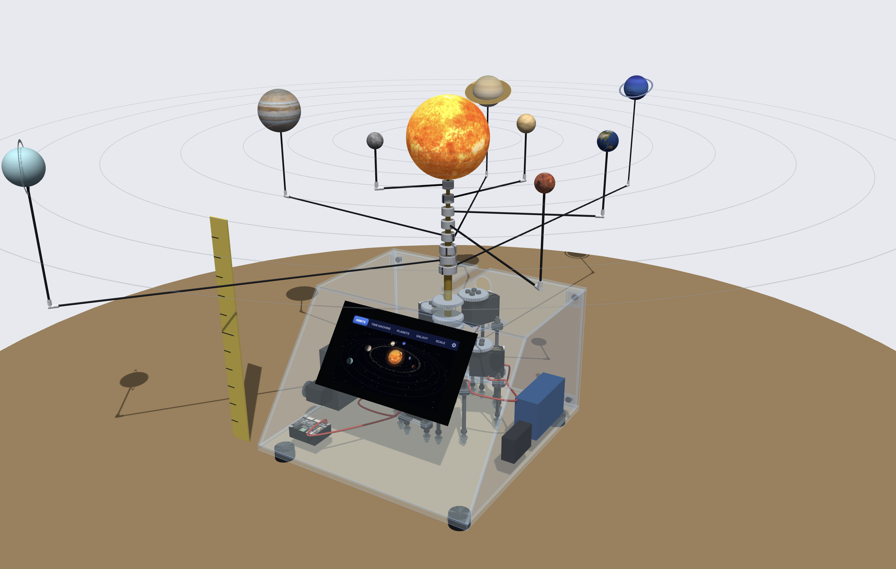

# 3D model

An interactive 3D model of the whole orrery: the clear box, the eight servos on their stands,
the column of nested brass tubes and gears, the arms, the planets and the Sun, all drawn to
the real sizes in inches. It was drawn before the build to check that everything fits, and it
is a good way to see how the parts go together.



The touchscreen on the model's front is the **real touchscreen program**
(`../pi/ui/index.html`) running in simulation mode (`../pi/ui/sim.js` stands in for the Pi),
and the planets on the model follow it. Pick a date or press Run on that little screen and
the model's arms move.

## Opening it

Browsers block a page opened straight from the disk from loading its pictures and the
touchscreen, so serve the **repository root** with any small web server:

```bash
python3 -m http.server 8000      # run in the repository's top folder
```

then open <http://localhost:8000/model-3d/>.

Drag to turn the view, scroll to zoom. The buttons on the left switch between views:

- **The model**: the finished orrery, with the touchscreen panel.
- **Parts & sizes**: every part labelled with its size and its code in the parts list (hover
  or click a part).
- **Build in 3D**: the column, stands and box put together one step at a time, plus the
  cutting plan and the servo mount.
- **Wiring diagram**: battery, switch, converters, Pi, screen and servos.

## Files

| File | What it is |
|---|---|
| `index.html` | The whole model: geometry, labels, views and controls (one file) |
| `vendor/three.min.js` | three.js r149, the 3D library (MIT licence) |

The photos printed on some parts in the original (sellers' product pictures) are not
included, so those parts show in plain colours.
